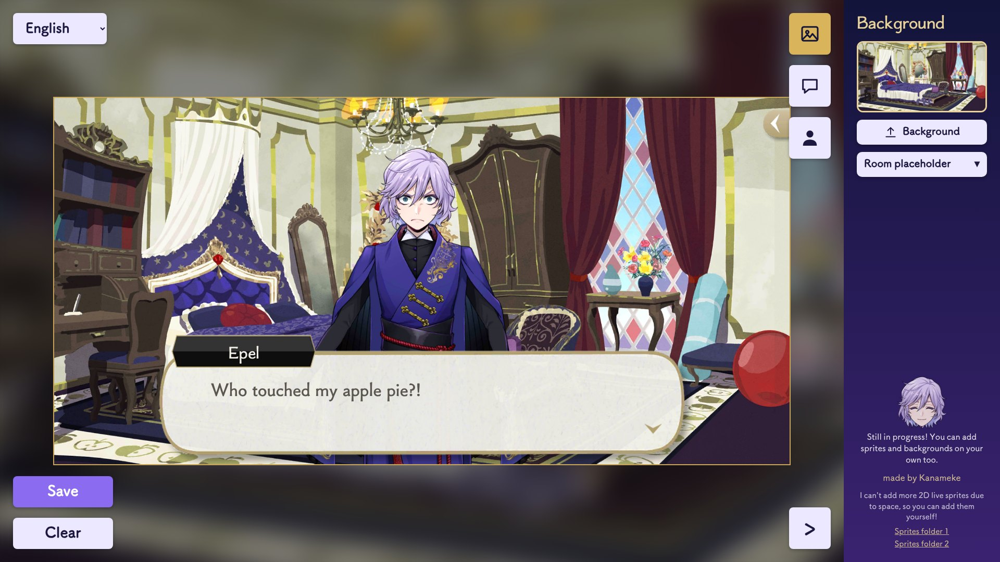
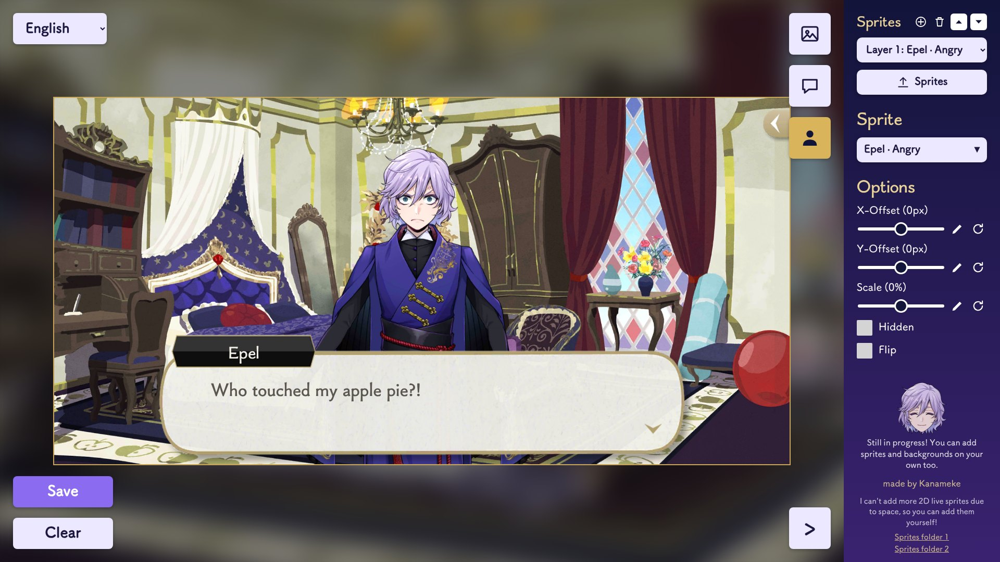
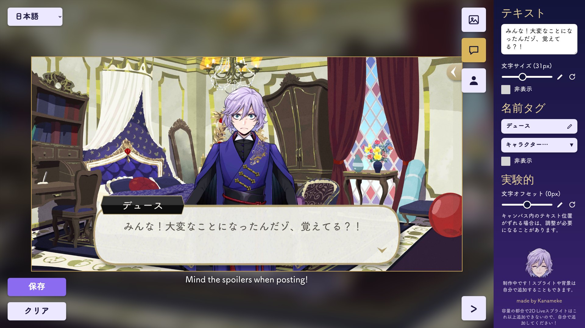
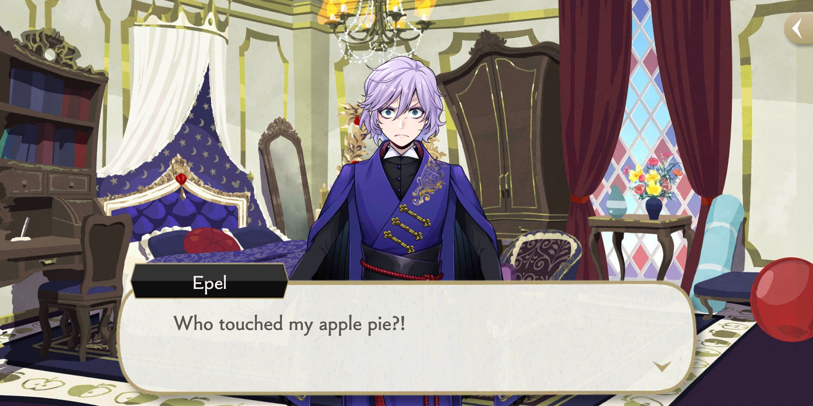
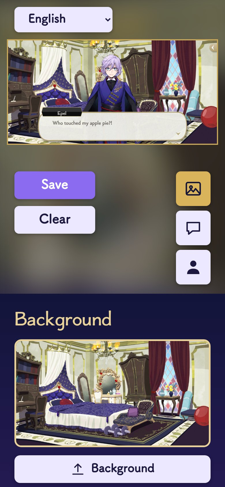
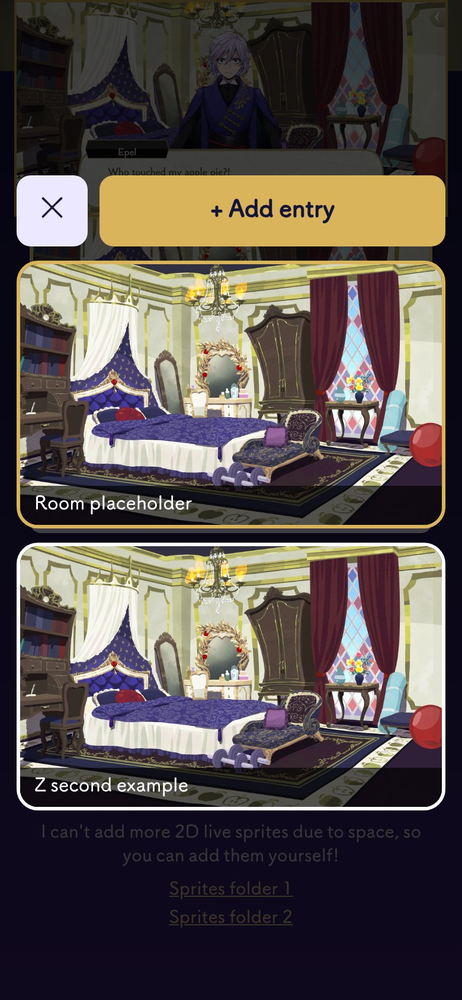
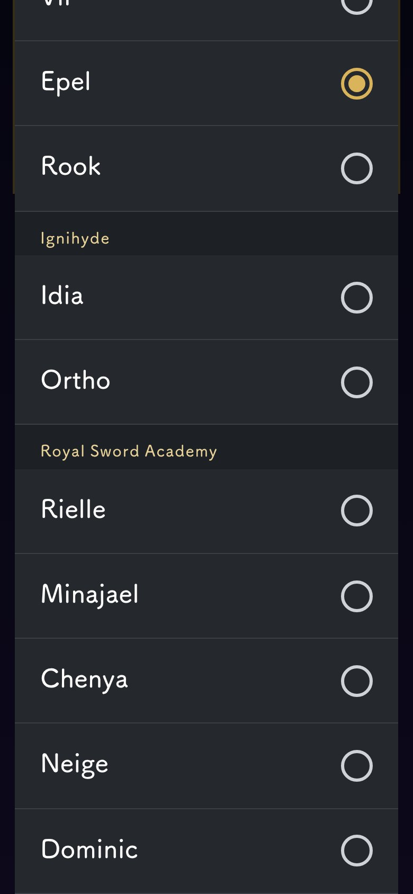
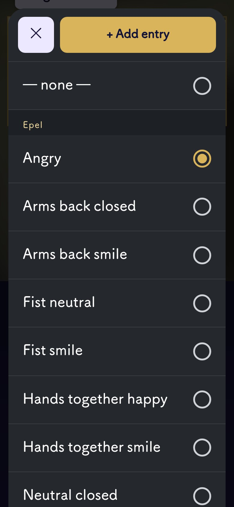

<h1 align="center">Twisted Wonderland Dialogue Sandbox</h1>

<p align="center">
  A little sandbox for building Twisted Wonderland dialogue boxes of your own! (because idk why I made this anyway haha pls don't sue me).<br>
  Pick a background, place sprites, type a line, and save it as a PNG. English and 日本語.
</p>

<p align="center">
  
  
  
  
</p>

<p align="center">
  
</p>

## Features

- **One scene, live preview.** A big framed canvas with the dialogue box, name tag and your sprites. Everything you change updates instantly.
- **Three tabs** (the buttons beside the canvas):
  - **Background**: preview, upload, and a gallery picker.
  - **Text**: dialogue text, font size, name tag, hide switches and a font offset.
  - **Sprites**: layers (add, delete, reorder), a sprite picker, X / Y offset, scale, hide and flip.
- **English and 日本語.** Switch the language at the top-left. The whole interface is translated, the dialogue uses the Japanese dialogue font, and the character list shows Japanese names.
- **Character list** grouped by dorm, including Royal Sword Academy (Rielle, Minajael, Chenya, Neige and more). Add your own names under **My characters**.
- **Sprite and background folders.** Drop images into `public/sprites/<character>/` or `public/backgrounds/` and they show up in the pickers.
- **Add entries from the page** with **+ Add entry** (name it and it is remembered in your browser).
- **Save** exports a 2560 x 1280 PNG that matches the preview. **Clear** empties the scene.
- Works on phones: the canvas stays pinned at the top while you scroll the panel.
- No build step, no dependencies. Plain HTML, CSS and JavaScript.

## Screenshots

| Text tab | Sprites tab | Japanese |
|---|---|---|
|  |  |  |

| Saved PNG | Mobile | Background gallery |
|---|---|---|
|  |  |  |

| Character picker | Sprite picker |
|---|---|
|  |  |

## Getting started

You need Python 3 (already on most computers). Run one of these from the project folder:

```bash
./start.sh        # Mac / Linux
start.bat         # Windows (double-click)
# or by hand:
python3 tools/make-manifest.py
python3 -m http.server 8080
```

Then open <http://localhost:8080>.

> **Why not just double-click `index.html`?** Browsers block saving images from pages opened as files, so **Save** would fail.
> Run it through the local server above (the start scripts do this for you).

The start scripts also rebuild the sprite and background list every time, so new files appear automatically.

## Using the sandbox

| Where | What it does |
|---|---|
| Top-left dropdown | Language: English / 日本語 |
| Right of the canvas | Tabs: Background, Text, Sprites |
| **Save** | Download the scene as a PNG |
| **Clear** | Empty the text, name and sprites |
| **>** (bottom, beside the panel) | Hide or show the side panel for a bigger canvas |
| Pencil icon next to a slider | Type an exact value |
| Reset icon next to a slider | Back to the default |

Your last scene is remembered in your browser, so a refresh will not lose it.

## Adding sprites (a folder per character)

Every character has a folder:

```
public/sprites/
├── epel/        # Epel's sprites (included)
├── rielle/
├── minajael/
├── deuce/
└── ...          # one folder for every character in the list
```

1. Put that character's sprites in their folder (PNG / WebP / JPG, transparent, all the same canvas size so they line up).
2. Update the list (see [Updating the list](#updating-the-list)).
3. Open the **Sprites** tab, tap the sprite field, and pick from the list under the character's name.

File names become the labels: `arms_back_smile.png` shows as "Arms back smile".
A character that is not listed? Make a new folder with their name inside `public/sprites/`.

Only Epel's sprites are included. No other official character art is bundled, so add your own.

## Adding backgrounds

Put images (JPG / PNG / WebP, 16:9 or 2:1 works best) in `public/backgrounds/`. Sub-folders are fine; the folder name shows in the label.
Then [update the list](#updating-the-list). They appear in the **Background** gallery.

## Updating the list

The page reads `src/sprites-manifest.js`, which lists every file in the sprite and background folders.
A website cannot scan folders by itself, so this file must be regenerated whenever you add or remove files:

| How you run it | What to do |
|---|---|
| On your computer | Run `start.bat` / `start.sh` (or `python3 tools/make-manifest.py`). |
| Hosted from GitHub | Push your new files. `.github/workflows/update-manifest.yml` rebuilds the list and commits it for you. |
| Uploading files by hand to a host | Run `tools/make-manifest.py` first, then upload the new `src/sprites-manifest.js` along with your images. |

**Nothing shows up in the pickers?** Open `your-site/src/sprites-manifest.js` in the browser.
A 404 means the file was not uploaded. `[]` means it was generated before you added the files.
The pickers also show a short hint when the list is empty.

## Add entries from the page (no files needed)

Every picker has **+ Add entry**. Choose an image, give it a name, and it appears in the list.
Character pickers have **+ Add name** for your own characters (shown under **My characters**).
These are saved in your browser, so they only exist on that browser and device. Browsers allow only a few MB, so many large images may not all be remembered (the page warns you).
Entries you added have a ✕ button to remove them.

## Fonts

| Used for | File |
|---|---|
| Name tag (and headings) | `public/fonts/Boucherie-Flared.ttf` |
| Dialogue text, English | `public/fonts/FOT-TsukuARdGothic-Std-B-interface.ttf` |
| Dialogue text, Japanese | `public/fonts/FOT-TsukuARdGothic-Std-R-Japanese-dialogue.ttf` |
| Interface text | `public/fonts/FOT-TsukuARdGothic-Std-R.ttf` |

The FOT fonts are commercial fonts. Make sure you have the right to use them and to redistribute them before you publish the project.
The font files are large (about 50 MB together), so the first load can be slow on a phone.

## Project structure

```
.
├── index.html
├── start.bat / start.sh            # build the list, start a local server
├── tools/make-manifest.py          # scans the sprite and background folders
├── .github/workflows/              # optional: auto-update the list on push
├── public/
│   ├── backgrounds/                # your backgrounds
│   ├── sprites/<character>/        # your sprites, one folder per character
│   ├── ui/                         # dialogue box art, Epel icon
│   ├── fonts/
│   └── screenshots/                # images used in this README
└── src/
    ├── app.js                      # all the logic: pickers, languages, Save PNG
    ├── styles.css
    ├── assets.js                   # character names (add more here)
    └── sprites-manifest.js         # generated list of sprites and backgrounds
```

Want a new character name in the list? Add it to `characters` in `src/assets.js`
(and a Japanese name to `JA` near the top of `src/app.js` if you want it translated).

## Troubleshooting

- **Save does nothing or shows an error:** open the page through the local server, not by double-clicking the file.
- **Sprites or backgrounds do not appear:** see [Updating the list](#updating-the-list).
- **The dialogue text sits in the wrong place:** use **Experimental > Font Offset** on the Text tab.
- **A scene saved by an older version looks empty:** press **Clear** and start again.

## Credits and disclaimer

Made by Kanameke (AKA THE ONE WHO MADE THAT PROFILE MAKER NICE TO MEET YAAAA). Still a work in progress.

This is an unofficial fan project and is not affiliated with or endorsed by Disney, Aniplex, F4samurai, or the developers of
*Disney Twisted-Wonderland*. Characters, artwork, UI graphics and fonts belong to their respective owners and are
included only as placeholders. Replace them with your own assets before you redistribute.
The code is released under the MIT License.
