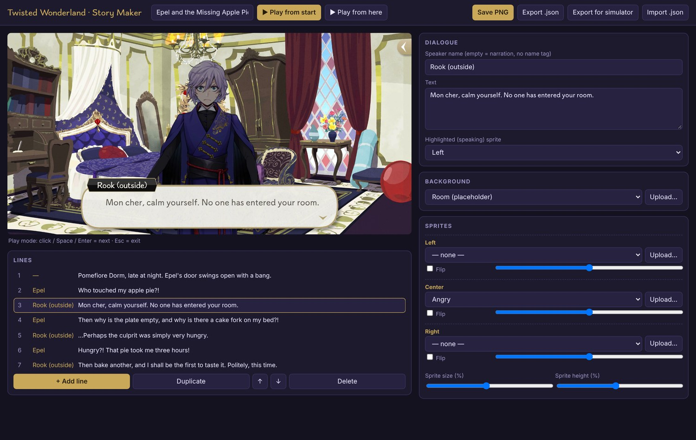
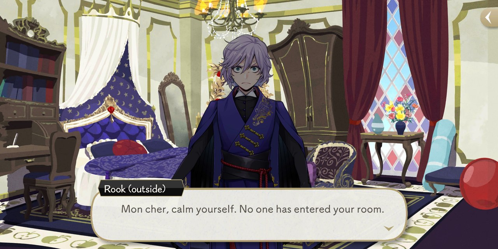

<h1 align="center">Twisted Wonderland Dialogue Sandbox</h1>

<p align="center">
  Play with Twisted Wonderland-style dialogue scenes, play them in a fullscreen simulator, and save any line as a PNG.
</p>

<p align="center">
  
  
  
  
</p>

<p align="center">
  
</p>

## Features

- **Scene editor**: speaker name, dialogue text, background, and three sprite slots (left, center, right) per line.
- **Sprite controls**: flip, horizontal offset, global size and height, and a "speaking" highlight that dims the other sprites.
- **Game-style dialogue UI**: box, name tag, and back button from the in-game layout. Text auto-shrinks if it would overflow the box.
- **Simulator**: title screen, typewriter text, fullscreen play, keyboard controls.
- **Save PNG**: export the current line at 2560x1280.
- **Import / Export**: save stories as `.json`, or export a `story.js` for the simulator.
- **Uploads**: add your own backgrounds and sprites from the editor.
- **No build step**: plain HTML, CSS and JavaScript.

## Screenshots

| Simulator title | Simulator play | Saved PNG |
|---|---|---|
|  |  |  |

## Getting started

```bash
git clone https://github.com/<your-name>/twst-story-maker.git
cd twst-story-maker
```

**Quick:** double-click `index.html` (editor) or `simulator.html` (player).

**With a local server** (needed for Save PNG unless you add the offline patch):

```bash
npm start            # or: python3 -m http.server 8080
# Windows: start.bat   Mac/Linux: ./start.sh
```

Then open <http://localhost:8080>.

> **Save PNG on `file://`**: browsers block image export when a page is opened by double-clicking it.
> Unzip `save-png-offline-patch.zip` into the project folder (adds `src/assets-data.js`) or use a local server.

## Controls

| Key | Action |
|---|---|
| Click / Space / Enter | Next line (finishes typing first) |
| Left arrow | Previous line |
| P | Save PNG of the current line |
| Esc | Exit play mode |

## Project structure

```
.
├── index.html                      # editor
├── simulator.html                  # fullscreen player (reads src/story.js)
├── localization-template-en.json   # UI strings template
├── package.json
├── start.bat / start.sh            # tiny local server launchers
├── public/
│   ├── backgrounds/                # background images
│   ├── sprites/                    # transparent PNG sprites (same canvas size)
│   ├── ui/                         # dialogue_ui.png (box + name tag + back button)
│   ├── fonts/                      # name font + dialogue font
│   └── screenshots/                # images used in this README
└── src/
    ├── app.js                      # editor, player, Save PNG
    ├── styles.css
    ├── assets.js                   # list of backgrounds, sprites, character names
    ├── lang.js                     # UI strings (en)
    └── story.js                    # story used by the simulator
```

## Adding your own assets

1. Put images in `public/backgrounds/` or `public/sprites/`.
2. Add an entry for each in `src/assets.js`.
3. Or skip the files and use the **Upload** buttons in the editor (stored inside the exported `.json`).

Sprites should be transparent PNGs that all share the same canvas size so they line up.

## Localization

Copy `localization-template-en.json`, translate the values, and paste them into `src/lang.js`.

## Contributing

Issues and pull requests are welcome. Please include a screenshot for visual changes.

## Credits and disclaimer

This is an unofficial fan project and is not affiliated with or endorsed by Disney, Aniplex, or the developers of
*Disney Twisted-Wonderland*. Characters, artwork, UI graphics, and fonts remain the property of their respective
owners and are included here only as placeholders; replace them with your own assets before redistributing.
The code is released under the MIT License.


## Adding sprites per character
Every character has a folder: `public/sprites/<name>/` (for example `public/sprites/epel/`, `public/sprites/rielle/`).
Drop that character's sprites (PNG / WebP / JPG, transparent, same canvas size) in their folder, then run `start.bat` / `start.sh` again
(or `python3 tools/make-manifest.py`). They appear under the character's name in the Sprites picker.
Need a character that isn't listed? Create a new folder with their name inside `public/sprites/`.

## Adding backgrounds
Drop images (JPG / PNG / WebP, 16:9 or 2:1 works best) into `public/backgrounds/` (you can use sub-folders to stay organised),
then run `start.bat` / `start.sh` again (or `python3 tools/make-manifest.py`). They appear in the Background gallery.
